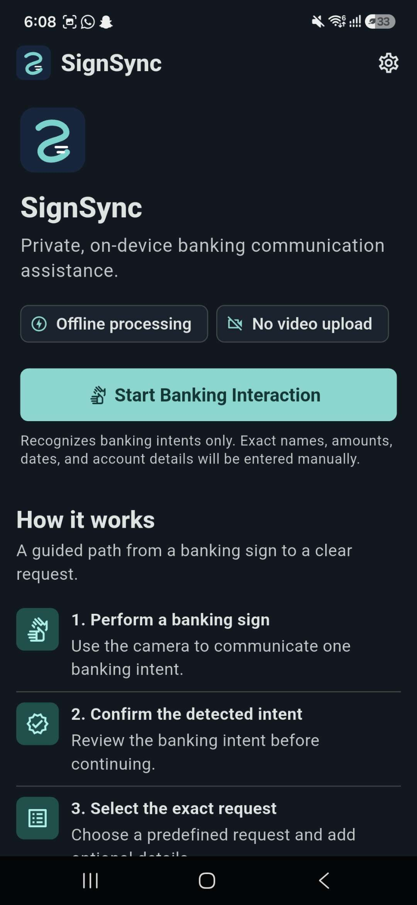
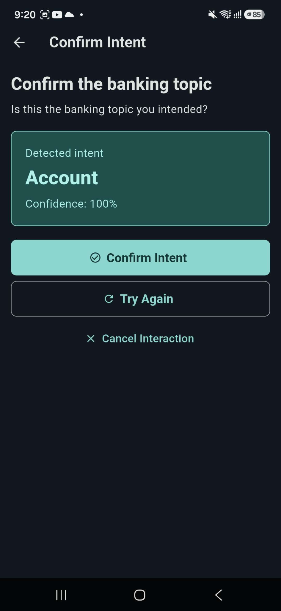
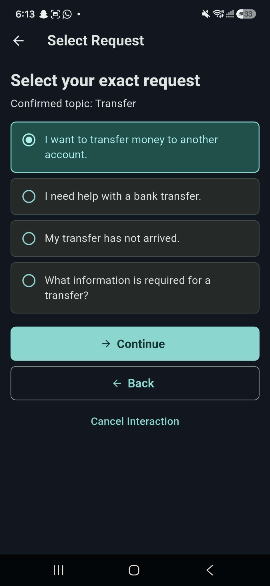
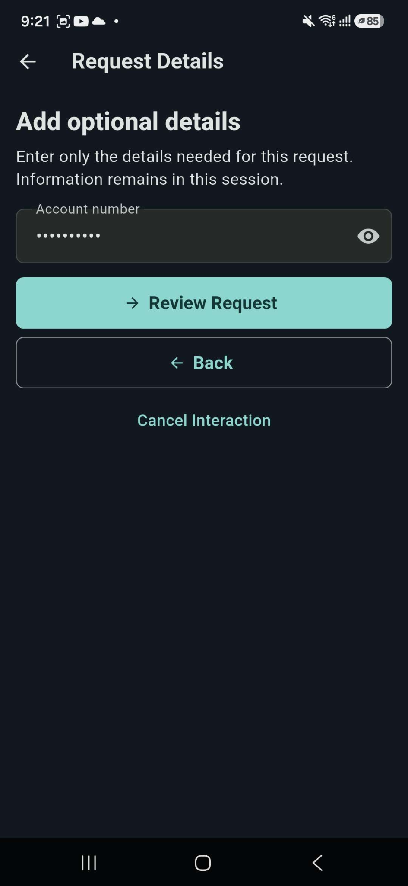
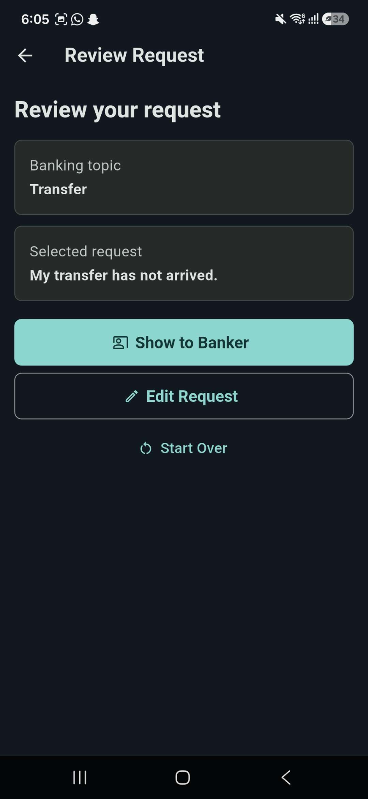
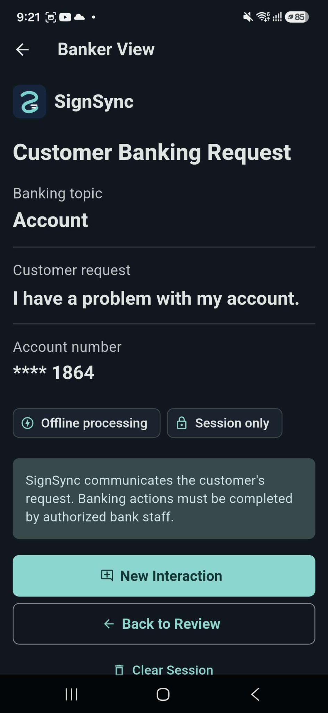
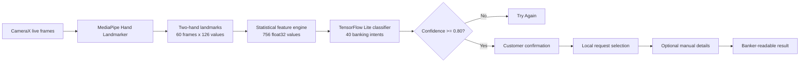
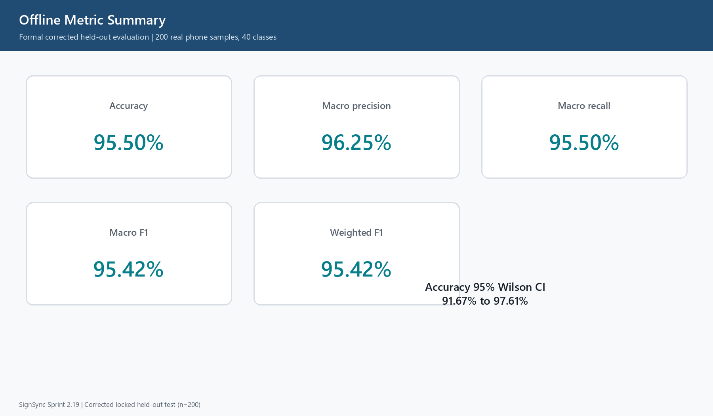

<div align="center">
  
  <h1>SignSync</h1>
  <p><strong>A real-time, on-device ASL-to-text framework for privacy-preserving banking service interactions.</strong></p>
  <p>
    A Final Year Project that turns isolated American Sign Language banking intents into a guided,<br />
    banker-readable request without uploading camera frames or relying on a cloud service.
  </p>

  <p>
    
    
    
    
    
    
  </p>

  <p>
    <a href="#product-walkthrough">Product</a> |
    <a href="#system-architecture">Architecture</a> |
    <a href="#evaluation">Evaluation</a> |
    <a href="#run-the-app">Run</a> |
    <a href="#research-scope">Research Scope</a>
  </p>
</div>

---

## Why SignSync?

Banking interactions often depend on fast, precise communication, yet many service environments do not provide immediate sign-language support. SignSync explores a focused alternative: recognize a customer's **banking intent on the phone**, let the customer confirm it, guide them to an exact request, and present clear text to bank staff.

The prototype deliberately keeps its scope narrow and defensible. It recognizes **40 isolated banking intents**, not arbitrary ASL sentences, and it does not authenticate customers, execute transactions, or connect to bank systems.

<div align="center">
  <table>
    <tr>
      <td align="center"><strong>40</strong><br />banking intents</td>
      <td align="center"><strong>1,000</strong><br />phone landmark samples</td>
      <td align="center"><strong>95.50%</strong><br />held-out accuracy</td>
      <td align="center"><strong>95.42%</strong><br />macro F1</td>
      <td align="center"><strong>100%</strong><br />on-device inference</td>
    </tr>
  </table>
</div>

## Product Walkthrough

SignSync takes the user through a complete communication flow: start an interaction, confirm the detected topic, choose the exact request, add only the necessary details, review, and present a banker-readable result.

<table>
  <tr>
    <td align="center"><br /><sub><strong>1. Private entry point</strong></sub></td>
    <td align="center"><br /><sub><strong>2. Confirm the intent</strong></sub></td>
    <td align="center"><br /><sub><strong>3. Select the request</strong></sub></td>
  </tr>
  <tr>
    <td align="center"><br /><sub><strong>4. Add exact details</strong></sub></td>
    <td align="center"><br /><sub><strong>5. Review safely</strong></sub></td>
    <td align="center"><br /><sub><strong>6. Present to staff</strong></sub></td>
  </tr>
</table>

## What Makes It Different

- **Local by design** - camera frames, landmarks, feature computation, and inference stay on the Android device.
- **Banking-specific vocabulary** - the final model is frozen to 40 practical banking intents.
- **Human confirmation** - recognition never jumps directly to a banking request; the customer confirms or retries first.
- **Exact details remain manual** - names, amounts, dates, account numbers, and other sensitive details are not inferred from the sign classifier.
- **Confidence-aware decisions** - predictions below the validation-selected `0.80` threshold become **Try Again**.
- **Traceable research pipeline** - dataset manifests, locked splits, model hashes, feature contracts, and TFLite parity artifacts are preserved.

## System Architecture



| Layer | Implementation |
|---|---|
| Mobile experience | Flutter and Dart |
| Native camera pipeline | Android CameraX with Kotlin |
| Hand tracking | MediaPipe Hand Landmarker, up to two hands |
| Frame contract | `60 x 126` (`21 landmarks x xyz x 2 hands`) |
| Feature contract | Mean, standard deviation, minimum, maximum, first and last frame: `6 x 126 = 756` |
| Classifier | Dense neural network `512 -> 256 -> 128 -> 40`, softmax output |
| Deployment | Dynamic-range and float32 TensorFlow Lite models |
| Decision policy | Banking-only output with a validation-selected confidence gate |
| Communication layer | Confirmation, local query selection, masked details, review and banker view |

## Evaluation

The final corrected model was selected using the validation set and evaluated once on a locked, 200-sample phone-landmark test set.

| Metric | Result |
|---|---:|
| Held-out samples | 200 |
| Classes | 40 |
| Accuracy | **95.50%** |
| Macro precision | **96.25%** |
| Macro recall | **95.50%** |
| Macro F1 | **95.42%** |
| Coverage at `0.80` confidence | **97.50%** |
| Accuracy among accepted predictions | **97.95%** |
| Try Again rate | **2.50%** |

<p align="center">
  
</p>

> These results describe the frozen evaluation conditions: isolated signs, one primary participant, one Samsung Galaxy A55 capture domain, and five held-out samples per class. They are not a claim of general ASL translation performance.

## Dataset and Model Integrity

- **1,000 active phone samples**: 25 samples for each of 40 intents.
- **Frozen split**: 600 training, 200 validation, and 200 locked test samples.
- **Training-only augmentation**: conservative translation, scale, rotation, and coordinate jitter.
- **No test-set tuning**: architecture, winner, epoch, and confidence threshold were selected before the final test evaluation.
- **Reproducible artifacts**: deterministic seeds, SHA-256 manifests, model metadata, label order, and TFLite verification records.
- **No raw video in Git**: the repository excludes laptop-camera recordings and retains structured landmark data and derived research artifacts only.

<details>
<summary><strong>View the 40 banking intents</strong></summary>

`deposit` | `withdraw` | `balance` | `transfer` | `account` | `card` | `pin` | `password` | `identity_verification` | `cash` | `payment` | `fee` | `loan` | `savings` | `open_account` | `close_account` | `fraud` | `block_card` | `help` | `confirm` | `statement` | `document` | `bill_payment` | `atm` | `branch` | `cheque` | `interest_rate` | `credit_card` | `debit_card` | `lost_card` | `replace_card` | `change_pin` | `reset_password` | `refund` | `signature` | `complaint` | `appointment` | `account_number` | `card_limit` | `daily_limit`

</details>

## Privacy by Design

```text
Camera frame -> landmarks -> features -> local TFLite inference -> confirmed request
      |                                                        |
      +-------------- no server, no cloud, no upload ---------+
```

SignSync requests camera access only for live recognition. It does not upload video, call a remote inference API, or store banking credentials. Manually entered details exist for the active interaction and are masked where appropriate in the presentation workflow.

## Run the App

### Requirements

- Flutter SDK compatible with the version declared in [`pubspec.yaml`](flutter_app/pubspec.yaml)
- Android SDK 24 or newer
- Android device or emulator; a physical device is required for meaningful camera testing
- Camera permission for live recognition

### Start from source

```powershell
git clone https://github.com/ALMAFLEHI/SignSync.git
cd SignSync\flutter_app
flutter pub get
flutter run
```

For a specific Android device:

```powershell
flutter devices
flutter run -d <device-id>
```

The deployed model, label metadata, MediaPipe task asset, and local banking-query content are bundled under [`flutter_app/assets`](flutter_app/assets).

## Repository Map

```text
SignSync/
|-- flutter_app/                 Flutter product and Android native pipeline
|   |-- android/                 CameraX + MediaPipe Kotlin integration
|   |-- assets/                  TFLite models, labels, queries and branding
|   |-- lib/                     Workflow, inference, privacy and UI logic
|   `-- test/                    Flutter unit and widget tests
|-- ml/
|   |-- data_phone/              Structured phone-landmark dataset artifacts
|   |-- models/                  Frozen model metadata, metrics and figures
|   |-- reports/                 Technical evaluation and usability evidence
|   |-- src/                     Dataset, training, export and validation scripts
|   `-- tests/                   Python pipeline validation
|-- releases/SignSync_RC1/       Release manifests, checksums and handover material
|-- assets/readme/               Public project walkthrough media
`-- CITATION.cff                 Academic citation metadata
```

## Validation Record

The final release-candidate validation recorded:

- **108 Flutter tests passed**
- **92 authoritative Python tests passed**
- Flutter static analysis passed
- Debug and release Android builds completed
- Samsung Galaxy A55 installation and workflow smoke test completed
- Model, dataset, query content, and release hashes verified

Detailed machine-readable metrics and reports are available in:

- [`ml/models/sprint_2_17_final_40class_account_corrected_v2`](ml/models/sprint_2_17_final_40class_account_corrected_v2)
- [`ml/reports/sprint_2_19_final_technical_evaluation`](ml/reports/sprint_2_19_final_technical_evaluation)
- [`ml/reports/sprint_2_20_minimal_usability_inspection`](ml/reports/sprint_2_20_minimal_usability_inspection)
- [`releases/SignSync_RC1`](releases/SignSync_RC1)

## Research Scope

SignSync is a completed **academic prototype**, not a production banking system.

- It recognizes isolated banking intents, not continuous ASL or arbitrary sentences.
- The primary dataset contains one participant and one Samsung Galaxy A55 capture domain.
- It does not authenticate users, access accounts, execute transactions, or integrate with a bank backend.
- Samsung A55 testing is deployment and workflow smoke evidence, not a large live-device accuracy study.
- No external Deaf-community participant study, banking-staff study, or formal accessibility certification is claimed.
- The release candidate uses an Android debug certificate for academic demonstration rather than Play Store distribution.

These limits are explicit so that the project can be evaluated on what it genuinely demonstrates: a complete, privacy-preserving, on-device recognition and communication pipeline.

## Academic Context

**Final Year Project title:**

*A Real-Time, On-Device ASL-to-Text Recognition Framework for Privacy-Preserving Banking Service Interactions*

Developed by **Mohammed Abdulsalam Almaflehi** as a Software Engineering Final Year Project.

If you reference this work, use the metadata in [`CITATION.cff`](CITATION.cff).

## Usage and Rights

This repository is published for academic review, demonstration, and portfolio purposes. No open-source license is granted; all rights are reserved by the author. The software must not be represented as a production banking, authentication, transaction, or emergency-access system.

---

<div align="center">
  
  <p><strong>Private by design. Clear by intent. Built on-device.</strong></p>
  <p><a href="https://github.com/ALMAFLEHI">github.com/ALMAFLEHI</a></p>
</div>
